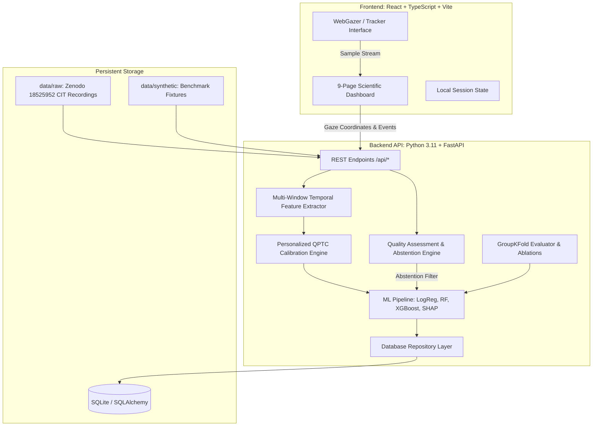

# GazeGuard AI — System Architecture Specification

## 1. Architectural Overview

GazeGuard AI is designed as a modular, decoupled research platform investigating **Quality-Aware Personalized Temporal Calibration (QPTC)** for Concealed Recognition Analysis.

## 2. Component Design

### 2.1 Quality-Aware Abstention Engine (`backend/app/quality/quality_checker.py`)
- Analyzes raw sample streams before feature extraction or inference.
- Evaluates:
  - Valid sample ratio $R_{\text{valid}} = \frac{N_{\text{valid}}}{N_{\text{total}}}$.
  - Early-window sample density $N_{t \le 500\text{ms}}$.
  - Timestamp jitter $\sigma_{\Delta t}$.
  - Hardware tracker confidence (when provided).
- Triggers abstention (`status = "insufficient_evidence"`) when $R_{\text{valid}} < \theta_{\text{quality}}$ (default $\theta = 0.60$).

### 2.2 Temporal Feature Extractor (`backend/app/features/extractor.py`)
- Implements I-VT (Velocity-Threshold Identification) fixation classification.
- Slices continuous trajectories into standardized temporal intervals:
  - $W_1 = [0, 500\text{ ms}]$: Primary visual orienting hypothesis window.
  - $W_2 = [500, 1000\text{ ms}]$: Intermediate appraisal window.
  - $W_3 = [1000, 2000\text{ ms}]$: Late exploratory window.
  - $W_{\text{overall}} = [0, T\text{ ms}]$: Total trial viewing duration.

### 2.3 Personalized Calibration Engine (`backend/app/calibration/calibrator.py`)
- Implements Mode A (Population Grand Mean) and Mode B (Personalized QPTC):
  $$z_{i, f} = \frac{x_{i, f} - \mu_{p, f}}{\sigma_{p, f} + \epsilon}$$
- **Strict Leakage Prevention**: Calibration baseline $(\mu_p, \sigma_p)$ is computed exclusively on neutral calibration or irrelevant stimuli, raising a runtime `ValueError` if probe/crime stimuli are detected.
- Safeguards for near-zero calibration variance ($\sigma < 10^{-3}$) and fallback to population parameters.

### 2.4 Machine Learning & Explainability Pipeline (`backend/app/models/ml_pipeline.py`)
- Implements standard, leak-free scikit-learn pipelines with median imputation and RobustScaler.
- Supported estimators: DummyClassifier, LogisticRegression (L2), RandomForestClassifier, XGBoost.
- Probability calibration: Sigmoid (Platt Scaling) and Isotonic regression fitted strictly on internal CV folds.
- Feature attribution: TreeSHAP and LinearSHAP for per-stimulus feature explanations.

### 2.5 Storage Layer (`backend/app/database/repositories.py`)
- Implements Repository Pattern isolating database operations.
- SQLite backend storing pseudonymous session IDs, derived feature summaries, calibration baselines, and experiment logs.
- **Privacy Enforcement**: Raw webcam video is never stored.
