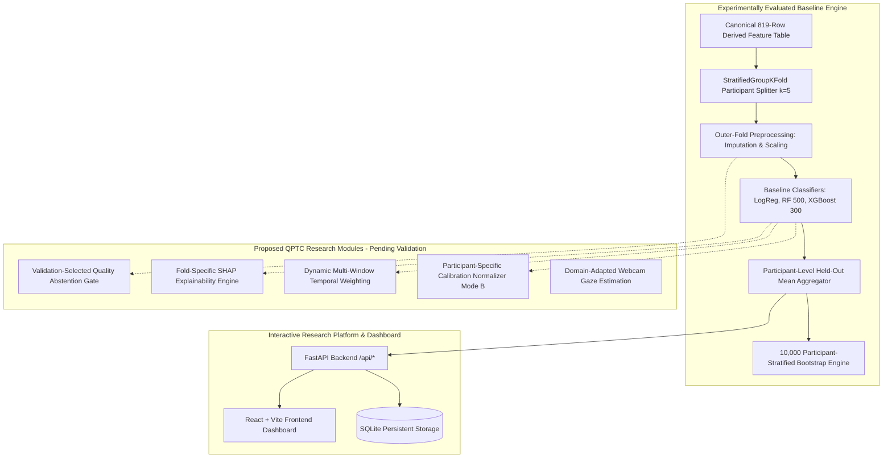

# GazeGuard AI — System Architecture Specification (Revision 12)

## 1. Architectural Overview & Research Taxonomy

GazeGuard AI contains both **experimentally evaluated baseline modules** (validated on the physical Zenodo CIT eye-tracking benchmark) and **proposed QPTC research modules** under active investigation.

---

## 2. Experimentally Evaluated Baseline Modules

These components are fully implemented, audited, and verified via `scripts/run_fresh_grouped_experiment.py` and `scripts/verify_experiment.py`:

| Module | Implementation | Validation Method |
| :--- | :--- | :--- |
| **Dataset Ingestion** | Ingests 819 rows across 38 participants from `data/processed/zenodo_features.csv`. | SHA-256 hash verified against `data/manifests/dataset_manifest.json`. |
| **Stratified Participant Split** | `StratifiedGroupKFold(n_splits=5, shuffle=True, random_state=42)` grouping on `participant_id`. | Zero training/test participant overlap verified across all folds. |
| **Outer-Fold Preprocessing** | SimpleImputer(median) and StandardScaler fit strictly on training folds. | Prevents data leakage between folds. |
| **Baseline Classifiers** | Logistic Regression ($L_2$, balanced), Random Forest (500 trees, depth 5), XGBoost (300 trees, depth 3). | Standardized Scikit-learn pipelines with fixed random seeds. |
| **Participant Aggregation** | Mean held-out row probability per participant: $\bar{p}_i = \frac{1}{M_i} \sum \hat{p}_{ij}$. | Evaluated at primary decision threshold $\bar{p} \ge 0.50$. |
| **Bootstrap Engine** | 10,000 participant-stratified resamples for 95% Confidence Intervals. | Independent sampling within control and guilty participant pools. |

---

## 3. Proposed QPTC Research Modules (Pending Empirical Validation)

These components represent the theoretical and algorithmic contributions of the proposed Quality-Aware Personalized Temporal Calibration (QPTC) framework, scheduled for formal validation in subsequent research phases:

| Module | Theoretical Function | Current Empirical Status |
| :--- | :--- | :--- |
| **Personalized Calibration (`Mode B`)** | Normalizes fixation features against individual neutral exposure baselines: $z = (x - \mu_{\text{calib}}) / (\sigma_{\text{calib}} + \epsilon)$. | **Proposed / Pending Validation.** In multi-item arrays with limited calibration trials ($N \le 7$), individual variance inflates test estimation error compared to regularized population baselines. Requires sufficiently powered neutral exposure datasets. |
| **Quality Abstention Gate** | Evaluates valid sample ratio ($R_{\text{valid}}$), jitter, and density; abstains when gaze tracking is degraded. | **Evaluated as an ablation curve.** Evaluated across fixed thresholds $\theta \in [0.40, 0.90]$. Dynamic validation-tuned threshold selection remains in development. |
| **Multi-Window Temporal Weighting** | Blends early visual orienting ($0–500\text{ ms}$), intermediate appraisal, and late exploration windows. | **Ablation Completed.** Evaluated via `scripts/run_temporal_ablation.py`. |
| **Fold-Specific SHAP Engine** | Computes TreeSHAP explanations per cross-validation fold without test data leakage. | **Proposed.** Synthetic prototypes exist in application; fold-specific real-data SHAP is scheduled for Phase 4. |
| **Webcam Estimation Adapter** | Translates browser WebGazer / MediaPipe RGB gaze coordinates to canonical CIT schema. | **Interactive Demonstration Only.** Not claimed to achieve laboratory eye-tracker accuracy. |

---

## 4. Software Architecture (Interactive Application)

- **Backend API (`backend/`):** Python 3.11 with FastAPI, providing RESTful endpoints (`/api/experiments/*`, `/api/trials`, `/api/sessions`, `/api/reports`).
- **Storage Layer:** SQLite via SQLAlchemy models (`backend/app/database/`), recording session metadata, gaze sample streams, and trial summaries.
- **Frontend Dashboard (`frontend/`):** React 18, TypeScript, Tailwind CSS, Lucide icons, and Recharts, providing an interactive research workstation for conducting live trials, visualizing scanpaths, and inspecting experiment results.
