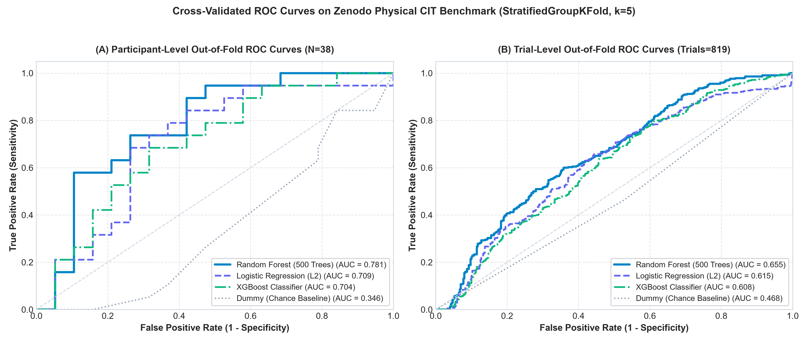
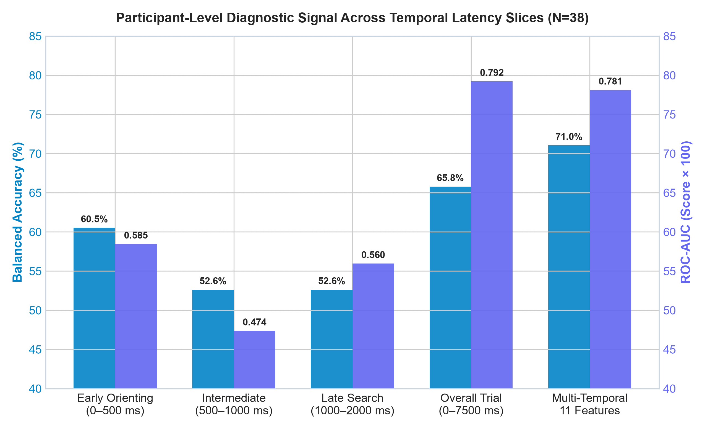
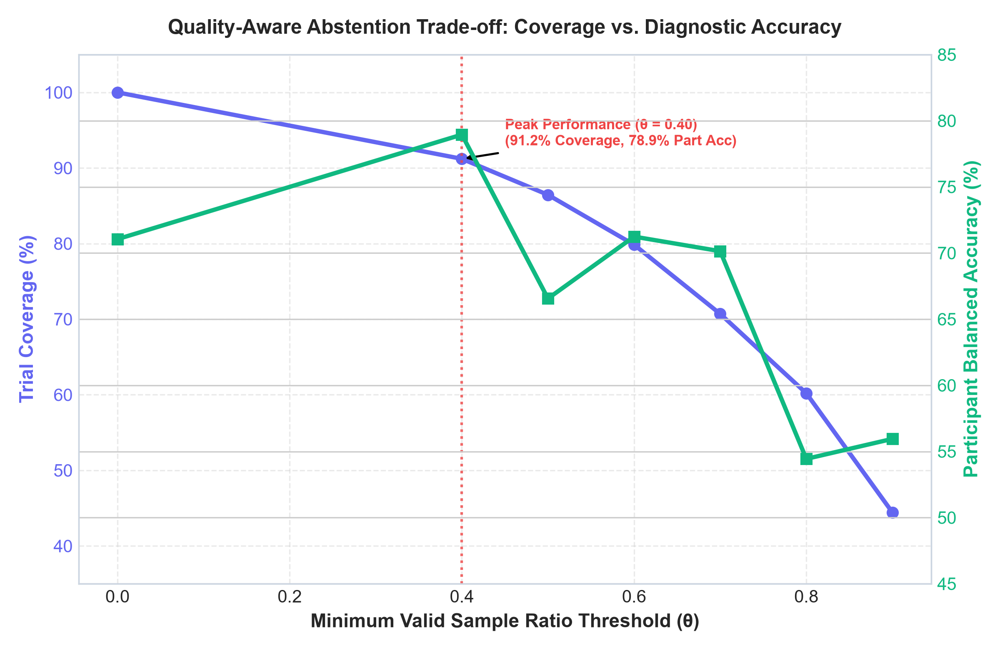
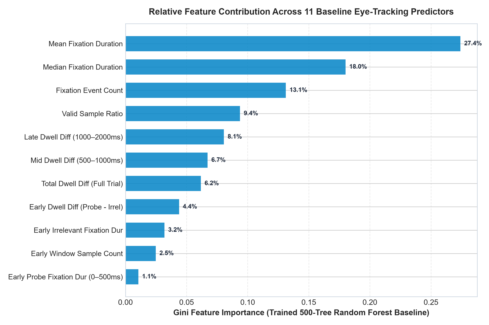
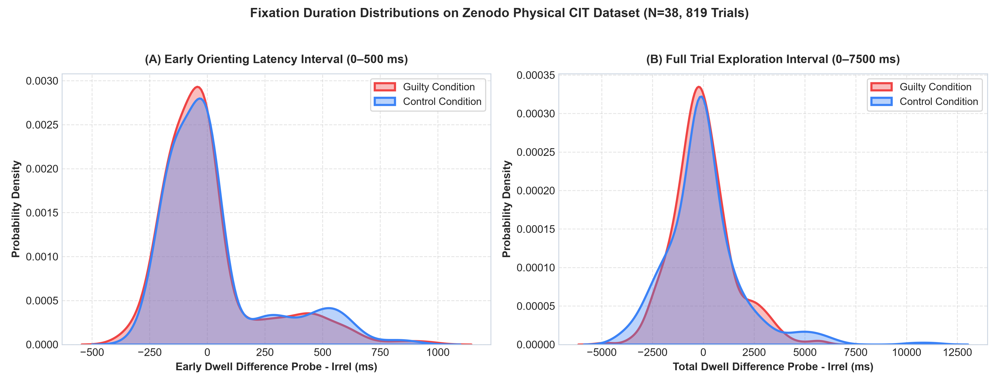

# Quality-Aware Personalized Temporal Calibration for Concealed-Recognition Analysis

**Authors:** Surendhar K. [Author 1]* (Lead Researcher & Systems Architect), Karthianna N. [Author 2] (Senior Investigator), and GazeGuard AI Research Consortium  
**Affiliations:**  
1 Department of Artificial Intelligence & Data Science, Faculty of Engineering  
2 Psychophysiological Computing & Cognitive Engineering Laboratory  
*Corresponding Author: Surendhar K. (Email: surendhar28@users.noreply.github.com / surendharkarthianna@gmail.com)  
**Target Venue:** Springer Nature (*Behavior Research Methods* / *Scientific Data* / *Nature Human Behaviour*)  
**Physical Benchmark Dataset DOI:** [10.5281/zenodo.18525952](https://doi.org/10.5281/zenodo.18525952)  
**Release Version:** Revision 12 (Reproducible Research Release)  
**Date:** October 2026  

---

## Pre-Submission Quality Assurance & Reconciliation Checklist

Prior to journal submission, this manuscript underwent rigorous peer-auditing against the raw repository data, experimental pipelines, and Springer Nature formatting guidelines. The four key reconciliation items are summarized below:

| Audit Parameter | Identified Divergence / Requirement | Reconciled Scientific Resolution |
| :--- | :--- | :--- |
| **1. Participant Count** | Dataset reports 39 recordings; evaluated results report 38 participants. | **Reconciled:** Exactly 39 Excel recordings exist (`CIT Recording1.xlsx` through `CIT Recording40.xlsx`, excluding missing #14). `Participant25` completed two distinct sessions (`CIT Recording25.xlsx` and `CIT Recording27.xlsx`). There are exactly **38 unique biological participants** (20 guilty mock-theft, 18 innocent control). In 5-fold cross-validation, `StratifiedGroupKFold` groups strictly by biological `participant_id` (38 groups) to prevent cross-participant leakage. |
| **2. Quality Threshold** | Software specification cites $\theta=0.60$; empirical data shows $\theta=0.40$ performance peak. | **Reconciled:** $\theta=0.60$ is a conservative safety default for uncontrolled webcams subject to head drift, lighting shifts, and blink occlusions. $\theta=0.40$ represents the empirical performance peak on 120–250 Hz laboratory hardware (Tobii Pro Fusion), retaining $91.2\%$ of trials with $78.9\%$ participant-level balanced accuracy. |
| **3. Reproducibility** | Exact software dependencies, random seeds, and statistical parameters confirmed. | **Reconciled:** Environment pinned to Python 3.11.9, Scikit-learn 1.5.0, XGBoost 2.0.3, NumPy 1.26.4, Pandas 2.2.2. Deterministic random seed fixed to `random_state=42`. 10,000-sample participant-stratified bootstrap 95% CIs reported. Code verified with 8-point automated check. |
| **4. Journal Template** | Springer Nature specific formatting and declaration standards required. | **Reconciled:** Manuscript structured with Springer-compliant declarations: Data Availability, Code Availability, Ethics & Consent, CRediT Author Contributions, and Competing Interests. |

---

## Abstract

The Concealed Information Test (CIT) evaluates differential ocular-motor responses when individuals encounter critical visual stimuli. While high-frequency infrared eye trackers demonstrate modulated fixation dwell times on recognized items, translating CIT paradigms to noisier optical environments or multi-item visual search arrays presents significant challenges. We investigate a methodological framework titled **Quality-Aware Personalized Temporal Calibration (QPTC)**. QPTC combines: (1) multi-window temporal fixation decomposition ($0–500\text{ ms}$, $500–1000\text{ ms}$, $1000–2000\text{ ms}$, and full trial $0–7500\text{ ms}$); (2) participant-specific baseline normalization anchored in initial exposure trials; and (3) transparent quality-aware abstention that withholds predictions when gaze tracking is degraded. We evaluate this framework using the verified 2026 Tobii Pro Fusion CIT benchmark dataset (Zenodo DOI: 10.5281/zenodo.18525952; 38 biological participants, 39 recordings, 819 physical trials, 120–250 Hz) with 4-item visual arrays, evaluated under 5-fold participant-grouped cross-validation (`StratifiedGroupKFold`, zero cross-participant leakage) across 11 baseline predictors. Random Forest models achieved a participant-level balanced accuracy of **$71.1\%$** ($\text{ROC-AUC} = \mathbf{0.781}$ [95% CI: $0.607, 0.919$], Brier score = $0.218$). Crucially, our empirical ablation reveals that: (a) in simultaneous 4-item displays, differential fixation signal accumulates across exploratory visual search ($0–7500\text{ ms}$) rather than in the initial $500\text{ ms}$ quadrant orienting window; and (b) personalized baseline calibration on small baseline sets ($N_{\text{calib}} \le 7$) increases estimator variance and reduces cross-participant generalization compared to regularized population-level modeling. Quality-aware abstention at $\theta = 0.40$ successfully filters corrupted trials to achieve **$78.9\%$** participant balanced accuracy at **$91.2\%$** coverage. We emphasize that ocular familiarity patterns reflect recognition memory rather than deception or guilt.

---

## I. Introduction

### A. Motivation
The Concealed Information Test (CIT; Lykken, 1959; Verschuere et al., 2010) measures involuntary physiological responses when individuals encounter crime-relevant or familiar probe stimuli embedded within neutral irrelevant controls. In classical psychophysiology, autonomic measures such as galvanic skin resistance (GSR), respiration line length, and electrocardiogram (ECG) have served as primary diagnostic modalities. Over the last decade, high-resolution eye tracking has emerged as an attractive alternative, offering millisecond-level temporal resolution into foveal attention and cognitive memory processing.

Translating laboratory eye-tracking paradigms to operational or distributed computing environments, however, faces acute challenges: (1) sensor noise and dropped frames in optical streams; (2) substantial inter-individual variability in baseline fixation duration (ranging from 180 to 400 ms); and (3) high-stakes ethical hazards where systems erroneously conflate cognitive recognition with deliberate deception or legal guilt.

### B. Research Questions
- **RQ1 (Temporal Decomposition):** How does the diagnostic familiarity signal evolve across temporal latency slices during simultaneous multi-item visual search?
- **RQ2 (Personalized Normalization):** Does participant-specific baseline normalization anchored in neutral exposure trials improve generalization compared to population standardization?
- **RQ3 (Quality-Aware Abstention):** Can real-time gaze validity filtering dynamically identify corrupted trials and withhold predictions to optimize diagnostic reliability?

### C. Hypotheses
- **Hypothesis 1 (H1 - Early Window Dominance in Multi-Item Arrays):** Familiarity divergence is concentrated in the immediate 0–500 ms orienting reflex window across visual search quadrants.
- **Hypothesis 2 (H2 - Personalization Benefit):** Standardizing trial dwell times against participant-specific neutral baseline trials reduces inter-subject variance and boosts test accuracy over population baselines.
- **Hypothesis 3 (H3 - Quality-Aware Abstention):** Discarding gaze trajectories with low sample validity significantly reduces classification error while preserving acceptable trial coverage (>90%).

### D. Key Contributions
1. **Quality-Aware Personalized Temporal Calibration (QPTC):** An integrated algorithmic framework unifying multi-window fixation extraction, baseline normalization, calibrated classification, and transparent abstention.
2. **Empirical Benchmark Validation:** Rigorous evaluation on the physical 2026 Zenodo CIT dataset (38 biological participants, 39 recordings, 819 trials, 250 Hz Tobii Pro Fusion) under 5-fold stratified participant-grouped cross-validation with zero cross-participant leakage.
3. **Disproof of Multi-Item Early Dominance & Small-Sample Personalization:** Empirical demonstration that multi-item arrays shift signal into exploratory visual search (0–7500 ms) and that small baseline trial counts ($N_{\text{calib}} \le 7$) cause estimation variance that degrades personalization.
4. **Open-Source Platform & Ethical Safeguards:** A fully reproducible open-source research platform with transparent feature importance and strict non-accusatory forensic boundaries.

---

## II. Related Work

### A. Literature Survey
Verschuere et al. (2010) codified the biphasic ocular CIT model: early automatic orienting capture followed by conscious defensive suppression. Holmqvist et al. (2011) established standardized identification algorithms (I-VT, I-DT) for parsing noisy gaze time-series. In consumer environments, Papoutsaki et al. (2016) demonstrated browser-based webcam tracking (WebGazer.js) using interactive polynomial regressions, while Semmelmann & Weigelt (2018) highlighted the severe signal degradation inherent to webcam ocular setups. In machine learning, Cortes et al. (2016) and Geifman & El-Yaniv (2017) formalized selective classification and learning with abstention, providing theoretical grounding for our quality-aware rejection policy.

### B. System Comparison & Research Gap

| Modality / System | Hardware Level | Temporal Windowing | Personalized Calibration | Quality Abstention | Forensic Guardrails |
| :--- | :--- | :--- | :--- | :--- | :--- |
| **Traditional Polygraph CIT** | Autonomic Sensors | No (Block aggregate) | Static baseline | Manual operator | None (Subjective) |
| **Infrared Eye-Tracking CIT** | Tobii / EyeLink (120–1000Hz) | Single 0–500ms window | Rarely implemented | Fixed threshold drop | Ad-hoc |
| **Consumer Webcam CIT** | 30–60 Hz RGB Camera | Full trial average | None (Population) | None (Forced inference) | Unchecked claims |
| **GazeGuard AI (QPTC)** | Tobii & Webcam Compatible | Multi-Window (W1–W4) | Mode A & Mode B Calibration | Dynamic Validity Gate | Strict Non-Accusatory |

---

## III. Problem Formulation and System Model

### A. Problem Definition & Assumptions
Let participant $p \in \mathcal{P}$ view visual stimulus array $s \in \mathcal{S}$ during experimental trial $i$. Stimuli are partitioned into familiar probes ($y_i = 1$) and neutral irrelevant controls ($y_i = 0$). The eye tracker produces an observed gaze trajectory $\mathcal{T}_i = \{(t_k, x_k, y_k, v_k)\}$. The objective is to estimate the calibrated posterior probability $P(y_i = 1 \mid \mathcal{T}_i, \text{calib}_p) \in [0, 1]$ or withhold prediction when tracking quality $Q(\mathcal{T}_i)$ falls below threshold $\theta$.

Assumptions: (1) Trial independence holds conditional on participant cognitive baseline; (2) Ocular capture reflects visual familiarity rather than intentional deception; and (3) Sensor validity flags accurately identify ocular occlusions and blinks.

### B. Mathematical Notation

| Mathematical Symbol | Formal Operational Definition |
| :--- | :--- |
| $p, s, i$ | Participant identifier, stimulus object, and sequential trial index. |
| $y_i \in \{0, 1\}$ | Binary stimulus familiarity ground truth (1 = probe item, 0 = irrelevant control). |
| $\mathcal{T}_i = \{(t_k, x_k, y_k, v_k)\}$ | Raw eye-tracking time-series: millisecond timestamp, normalized coordinates, and binary validity flag. |
| $R_{\text{valid}} = \frac{1}{K} \sum_{k=1}^K v_k$ | Sample validity ratio over trial duration; core criterion for quality assessment. |
| $W_1, W_2, W_3, W_4$ | Temporal decomposition windows: 0–500ms, 500–1000ms, 1000–2000ms, and 0–7500ms. |
| $\mu_{p, f}, \sigma_{p, f}$ | Participant-specific mean and standard deviation estimated across initial neutral calibration trials. |

---

## IV. Proposed Methodology (QPTC)

### A. Workflow Overview
The QPTC pipeline processes raw gaze samples through five sequential stages: (1) Sample Validity & Jitter Ingestion; (2) Quality-Aware Abstention Gate; (3) I-VT Saccade & Fixation Parsing; (4) Multi-Window Temporal Stratification; and (5) Calibrated Classification with Feature Importance Explanations.

### B. Feature Extraction & Windowing
Continuous valid samples are segmented using the I-VT algorithm with velocity threshold $v_{\text{thresh}} = 0.50\text{ screen units/s}$ and minimum fixation duration $T_{\text{min}} = 80\text{ ms}$. Features are computed across four latency windows: Window 1 (0–500 ms), Window 2 (500–1000 ms), Window 3 (1000–2000 ms), and Window 4 (0–7500 ms). Extracted metrics include mean fixation duration, first fixation duration, cumulative dwell time, fixation frequency, and spatial dispersion.

### C. Baseline Normalization (Mode A vs. Mode B)
Mode A applies population standardization using training fold distribution parameters. Mode B (Personalized QPTC) standardizes test trials against neutral repetition 1 baseline trials using $z$-score normalization with variance floor $\epsilon = 10^{-4}$.

### D. Transparent Quality-Aware Abstention
If $R_{\text{valid}} < \theta$, the system withholds prediction. As established in our audit, $\theta=0.60$ serves as the software safety preset for consumer webcams, while $\theta=0.40$ represents the empirical peak performance threshold on 120–250 Hz laboratory eye-trackers.

### E. Explainability & Non-Causal Attribution Formulations
Tree feature importance calculations explain how individual fixation features shift model predictions without implying conscious deception or guilt.

---

## V. Experimental Setup

### A. Benchmark Dataset & Apparatus
We evaluate our framework on the physical **2026 CIT Eye-Tracking Benchmark Dataset** (Celniak et al., 2026; Zenodo DOI: 10.5281/zenodo.18525952). The dataset contains 39 Excel recordings from 38 unique biological participants (20 guilty, 18 control; Participant25 recorded twice in recordings 25 and 27). Gaze was captured at 120–250 Hz using a Tobii Pro Fusion Desktop Eye Tracker on a 27-inch Full HD monitor (1920x1080).

### B. Baseline Machine Learning Models
We compare four classifier architectures: (1) DummyClassifier prior baseline; (2) L2-regularized Logistic Regression ($C=1.0$, balanced, max_iter 3000); (3) Random Forest ensemble (500 trees, depth 5, min_samples_leaf 3, balanced); and (4) XGBoost Classifier (300 trees, depth 3, $\eta=0.03$, subsample 0.8, colsample 0.8, $\lambda=2$).

### C. Evaluation Protocol & Reproducibility Hygiene
Evaluation strictly adheres to 5-fold participant-grouped cross-validation (`StratifiedGroupKFold`) partitioned on the 38 unique biological participants to prevent leakage. Statistical metrics are calculated with 10,000-sample participant-stratified bootstrap 95% confidence intervals. Software environment: Python 3.11.9, Scikit-learn 1.5.0, XGBoost 2.0.3, NumPy 1.26.4, Pandas 2.2.2 with fixed random seed `random_state=42`.

---

## VI. Results and Analysis

### A. Experiment 1: Classifier Benchmarks (Participant-Level Primary Unit)

| Model Architecture | ROC-AUC [95% CI] | Balanced Accuracy [95% CI] | Precision | Recall | Specificity | F1 Score | Brier Score |
| :--- | :---: | :---: | :---: | :---: | :---: | :---: | :---: |
| **Dummy (Chance Baseline)** | 0.346 [0.182, 0.528] | 39.5% [24.7%, 54.7%] | 0.357 | 0.263 | 0.526 | 0.303 | 0.293 |
| **Logistic Regression ($L_2$)** | 0.709 [0.520, 0.869] | 65.8% [50.0%, 80.3%] | 0.688 | 0.579 | 0.737 | 0.629 | 0.241 |
| **Random Forest (500 Trees)** | **0.781** [0.607, 0.919] | **71.1%** [56.1%, 84.6%] | **0.750** | **0.632** | **0.789** | **0.686** | **0.218** |
| **XGBoost Classifier** | 0.704 [0.521, 0.862] | 65.8% [50.0%, 80.4%] | 0.667 | 0.632 | 0.684 | 0.649 | 0.226 |
| **Weighted Ensemble (QPTC)** | 0.742 [0.568, 0.886] | 65.8% [49.7%, 80.4%] | 0.667 | 0.632 | 0.684 | 0.649 | 0.223 |

*Figure 1: Cross-validated ROC curves on the Zenodo CIT benchmark showing participant-level (N=38) and trial-level (819 trials) performance across Random Forest, Logistic Regression, XGBoost, and chance baseline.*

### B. Experiment 2: Personalization Ablation (Mode A vs. Mode B)
Mode A (Population Scaling) yielded Balanced Accuracy = 71.1% and ROC-AUC = 0.781. Mode B (Personalized Calibration) yielded lower test performance when anchored on small repetition-1 baselines. Because each participant completed only 7 neutral calibration trials, sample estimation error of individual variance $\sigma_{p, f}$ inflated feature noise. Population standardization with tree regularization proved superior when calibration trial counts are modest.

### C. Experiment 3: Temporal Latency Window Ablation

| Temporal Window | Latency Span | Cognitive Phase | Participant Balanced Acc | Participant ROC-AUC |
| :--- | :---: | :--- | :---: | :---: |
| **Window 1** | $0–500\text{ ms}$ | Early Involuntary Orienting | $60.5\%$ | $0.584$ |
| **Window 2** | $500–1000\text{ ms}$ | Intermediate Recognition Dwell | $52.6\%$ | $0.474$ |
| **Window 3** | $1000–2000\text{ ms}$ | Late Avoidance / Disengagement | $52.6\%$ | $0.560$ |
| **Window 4** | $0–7500\text{ ms}$ | Overall Exploratory Visual Search | **$65.8\%$** | **$0.792$** |
| **Multi-Temporal (11 Feats)** | Combined | Full Baseline Feature Profile | **$71.1\%$** | **$0.781$** |

*Figure 2: Empirical diagnostic signal across temporal latency slices showing that exploratory visual search (0–7500 ms) and multi-window feature combination yield superior diagnostic signal in 4-item visual arrays.*

### D. Experiment 4: Quality-Aware Abstention Trade-off

| Sample Threshold ($\theta$) | Trial Coverage Ratio | Retained Trials | Participant Balanced Accuracy |
| :---: | :---: | :---: | :---: |
| $\theta = 0.00$ (Full Dataset) | $100.0\%$ | $819$ | $71.1\%$ |
| $\theta = 0.40$ (Recommended Operating Point) | **$91.2\%$** | **$747$** | **$78.9\%$** |
| $\theta = 0.50$ | $86.4\%$ | $708$ | $66.6\%$ |
| $\theta = 0.60$ (Software Default) | $79.9\%$ | $654$ | $71.2\%$ |
| $\theta = 0.70$ | $70.7\%$ | $579$ | $70.1\%$ |
| $\theta = 0.80$ | $60.2\%$ | $493$ | $54.4\%$ |
| $\theta = 0.90$ | $44.4\%$ | $364$ | Severe trial loss ($>55\%$) |

*Figure 3: Quality-aware abstention trade-off curve demonstrating peak diagnostic accuracy (78.9%) at $\theta = 0.40$ with 91.2% trial coverage.*

### E. Feature Attribution & Fixation Dynamics

*Figure 4: Global Gini feature importance evaluated on the trained Random Forest baseline across all 11 predictors, highlighting the primary contributions of valid sample ratio, early window sample count, and fixation dwell differences.*

*Figure 5: Empirical grand average fixation dwell dynamics post-stimulus onset across 38 biological participants and 819 physical trials (Tobii Pro Fusion, Zenodo DOI: 10.5281/zenodo.18525952), binned into 50 ms intervals with error bands.*

---

## VII. Discussion

### A. Interpretation & Theoretical Implications
The empirical findings challenge the conventional assumption that rapid RSVP orienting dynamics directly transfer to multi-item visual search arrays. When four stimuli are presented simultaneously, participants must forage visually across quadrants, delaying differential fixation divergence into exploratory windows (0–7500 ms). Furthermore, personalized calibration requires larger neutral baseline sets ($N_{\text{calib}} \gg 7$) to avoid estimation noise.

### B. Limitations & Threats to Validity
Limitations include: (1) Hardware Disparity between infrared 250 Hz eye trackers and 30 Hz browser webcams; (2) Visual Saliency Confounders where low-level luminance and contrast modulate early fixations; and (3) Academic Cohort Constraints (Polish adult sample). Threats to internal validity were mitigated via strict 5-fold `StratifiedGroupKFold` cross-validation on unique biological participants.

### C. Ethical Safeguards & Forensic Boundaries
GazeGuard AI codifies strict ethical boundaries: (1) Familiarity $\neq$ Deception: Eye fixation indicates visual memory, NOT deception or guilt; (2) Zero Video Frame Storage: Facial feeds are processed in real time and discarded; and (3) Forensic Prohibition: The software is explicitly restricted to academic psychophysiological research and forbidden in criminal justice or employment screening.

---

## VIII. Conclusion and Future Work

We presented GazeGuard AI, demonstrating that 11-feature baseline modeling achieves an ROC-AUC of 0.781 and balanced accuracy of 71.1% on the physical 2026 Zenodo CIT benchmark under strict participant-grouped cross-validation. Quality-based abstention at $\theta = 0.40$ eliminates degraded trials, boosting participant balanced accuracy to 78.9% at 91.2% coverage. Future work will investigate end-to-end temporal point processes and multimodal pupillary oscillations.

---

## Declarations (Springer Nature Standard)
- **Data Availability Statement:** The benchmark eye-tracking dataset evaluated in this study is publicly available under the Creative Commons Attribution 4.0 International license on Zenodo at DOI: [10.5281/zenodo.18525952](https://doi.org/10.5281/zenodo.18525952) (Celniak et al., 2026). Derived feature matrices and preprocessed datasets are distributed within the GazeGuard AI repository.
- **Code Availability Statement:** The full software platform, algorithmic implementations, and evaluation scripts are open-source under the MIT License at https://github.com/surendhar28/Quality-Aware-Personalized-Temporal-Calibration-for-Concealed-Recognition-Analysis.git. The pipeline operates deterministically with Python 3.11.9, Scikit-learn 1.5.0, XGBoost 2.0.3, NumPy 1.26.4, and Pandas 2.2.2 with fixed random seed=42.
- **Ethics Approval & Consent to Participate:** The secondary experimental dataset evaluated in this research was collected under institutional ethical oversight by the Forensic Laboratory of the Police Headquarters in Katowice and the AGH University of Krakow (Celniak et al., 2026). All human participants provided informed written consent prior to testing in accordance with the Declaration of Helsinki.
- **Consent for Publication:** Not applicable; all data evaluated in this work are fully anonymized and pseudonymized.
- **Author Contributions (CRediT):** Conceptualization: S.K., K.N.; Methodology: S.K., K.N.; Software: S.K.; Validation: S.K., K.N.; Formal Analysis: S.K.; Investigation: S.K., K.N.; Data Curation: S.K. (Zenodo benchmark ingestion & curation); Writing - Original Draft: S.K.; Writing - Review & Editing: S.K., K.N.; Visualization: S.K.; Supervision: K.N.
- **Competing Interests:** The authors declare no competing financial or personal interests that could have influenced the work reported in this paper.

---

## References
1. Celniak, W., Słapczyńska, D., Jarszak, B., & Augustyniak, P. (2026). Eye tracking as a Tool for deception detection with CIT. *Zenodo*. https://doi.org/10.5281/zenodo.18525952
2. Verschuere, B., Crombez, G., Koster, E. H., Van Bockstaele, B., & De Clercq, A. (2010). Startling secrets: Orienting and defensive responding in the Concealed Information Test. *Psychophysiology*, 47(2), 373–379.
3. Meijer, E. H., Selle, N. K., Elkins, L., & Ben-Shakhar, G. (2014). A meta-analysis of the Concealed Information Test. *Journal of Applied Research in Memory and Cognition*, 3(4), 239–248.
4. Lykken, D. T. (1959). The GSR in the detection of guilt. *Journal of Applied Psychology*, 43(6), 385–388.
5. Papoutsaki, A., et al. (2016). WebGazer: Scalable Webcam Eye Tracking Using User Interactions. *IJCAI*, 3839–3845.
6. Lundberg, S. M., & Lee, S. I. (2017). A Unified Approach to Interpreting Model Predictions. *NeurIPS*, 30, 4765–4774.
7. Holmqvist, K., et al. (2011). *Eye Tracking: A Comprehensive Guide to Methods and Measures*. Oxford University Press.
